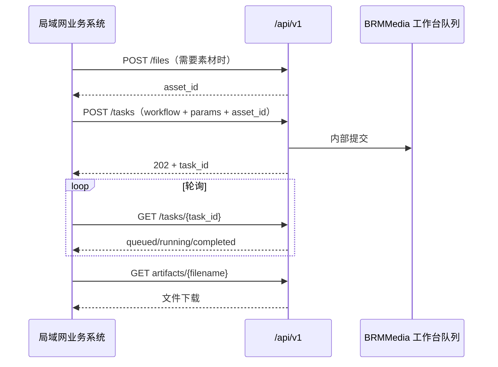

# BRMMedia 局域网 API

> **更新日期：2026-11-23**
> **当前生产主力模型矩阵（已完成精简与性能升级）**：
> - **图像创作**：单实例 **ComfyUI v0.39.0**（`:8188`，已合并 Qwen-Image-2.1 并下线独立 `:8190` 进程），主力包括 **`Qwen Image 2.1 Turbo`（8 步极速 · ~8s 出图，默认主力推荐；支持切换 40 步高精模式）**、`Z-Image Turbo`、`FLUX.2 Klein`（`flux2-fast-edit` 4 步极速编辑与 `image-edit` 基础编辑）；`POST /api/v1/tasks` 支持可选 `auto_enhance: true`（调用双 A4000 Strata `:8002` 零 GPU0 开销异步扩写 Prompt，默认 `false`）。
> - **语音克隆 & TTS**：**`ZONOS3-Mini`（`zonos3-voice-clone`，~3.3s 极速零显存语音克隆，CPU 直连 `:1919` 输出 WAV，支持 1..4 并发及 >300 字长文本自动分段并行合成与淡入淡出无缝拼接，重启历史任务状态持久化不丢失，默认主力推荐）**、**`Breeze-TTS2 最新优化版`（`breeze-tts2-voice-clone`，高自然度华语/中英混读情感克隆，支持 `[笑]`/`[叹气]` 情感标签，CPU 零显存 `:9206` 独立 1 槽位不阻塞 Zonos3，输出 24kHz WAV）** 与 **`IndexTTS-2.5`（`voice-clone`，`:9205` GPU 语音克隆，高表现力情感克隆，输出 MP3）**。
> - **音乐生成**：**`ACE-Step 1.5 XL`（`base` 50 步强歌词遵循 / `turbo` 8 步极速）** 与 **`YuE2-3B`（`yue2-3b-music` / `music-generate` `model="yue2"` 符号 ABC 乐谱规划+音频融合）** 双引擎，内置中文标签映射英文声乐标签及纯文本歌词自动分段结构化（`[Verse 1]` / `[Chorus]`）。
> - **视频生成 & 媒体超分**：**`MiniMax H3 Video`**（内置 `VAEDecodeTiled` 分块解码降显存）、**`LTX-2.3`**（文生视频 / 图生视频 / 首尾帧 / 数字人，全线启用 `VAEDecodeTiled`）与 **`SeedVR2`**（7B / 3B INT8 图像与视频超分修复）。
> - **已下线淘汰的旧入口**：`MiniMax-H3-Image`（旧版 480s）、`FLUX 3 Klein`（实验 341s）、`Qwen3-TTS 1.7B`、`ACE-Step SFT` 已从前端工作台与 `/api/v1/capabilities` 下架；REST 兼容层保留透明重定向（`h3-image-*` / `flux3-*` → `qwen-image21` Turbo 8 步，`qwen3-voice-clone` → `zonos3-voice-clone`，`ace-step-sft` → `music-generate` `model=turbo`），确保旧调用方零报错平滑过渡。

## 语音克隆音色库与三引擎（ZONOS3-Mini / Breeze-TTS2 / IndexTTS-2.5）

三套引擎共享内置参考音色素材包（包含睡前故事音色与古诗朗诵音色）。REST 先通过 `POST /api/v1/files?kind=audio` 上传参考音频，再将返回的 `asset_id` 传入 `ref_audio_asset_id`（`zonos3-voice-clone` 与 `breeze-tts2-voice-clone` 也支持省略参考音频直接合成，`zonos3-voice-clone` 还支持直接传入 `speaker_audio_base64`）。

| 男声音色 | ID | 女声音色 | ID |
| --- | --- | --- | --- |
| 睡前·暖声叔叔 | `bedtime-warm-male` | 睡前·轻声姐姐 | `bedtime-soft-female` |
| 睡前·沉稳男旁白 | `bedtime-narrator-male` | 睡前·温柔女声 | `bedtime-gentle-female` |
| 睡前·童话男声 | `bedtime-fable-male` | 睡前·沉静女旁白 | `bedtime-narrator-female` |
| 古诗·清雅书生 | `poetry-scholar-male` | 古诗·柔和女声 | `poetry-graceful-female` |

### 语音克隆并发与服务边界

- **`zonos3-voice-clone`（推荐主力）**：由独立 CPU 引擎 `ZONOS3-Mini`（`127.0.0.1:1919/v2/generate`）提供服务，**零显存占用**，支持 **1..4 并发**（`voice_cpu` 跨进程槽位闸门），不与 A5000 图像/视频/音乐队列争抢 GPU；文本 **>300 字符**时自动按句/换行边界切分（单段上限 220 字），在空闲槽位上**并行合成**并通过 **18ms 线性淡入淡出**无缝拼接为完整 44.1kHz WAV；支持 `zh`/`cmn`、`en`/`en_us`/`en_gb`、`ja`、`ko`、`fr`/`fr_fr`、`de`、`es`、`pt`/`pt_br`、`it`、`ru`；任务状态持久化至磁盘，重启 `brmmedia-lan-api` 不丢失历史产物。
- **`breeze-tts2-voice-clone`（华语/中英混读情感克隆 · 独立 CPU 槽位）**：由独立 CPU 引擎 `Breeze-TTS2 最新优化版`（`127.0.0.1:9206/v1/voice-clone`）提供服务，**零显存占用**，基于 `Breeze-TTS-2.cpp` (`Q8_0` GGUF + OpenBLAS) 并预缓存全部内置音色编码；占用独立 `voice_breeze`（**1 并发**）槽位，**不会阻塞 Zonos3 的 4 并发槽位**；支持中英混读、情感副语言标签（如 `[笑]`、`[叹气]`、`(laugh)`、`(sigh)`）、`speed`（`0.5–2.0`）、`instruction` 与 `cfg_scale`（`1.0–5.0`），输出 24kHz WAV（>420 字符自动分段拼接）。
- **`voice-clone`（IndexTTS-2.5 GPU 语音克隆 / 兼容路由）**：默认路由到 `IndexTTS-2.5`（`:9205`，归属 `audio_gpu` 档位，输出 MP3），亦可通过 `tts_engine="zonos3"` 路由到 `ZONOS3-Mini`，或通过 `tts_engine="breeze_tts2"` 路由到 `Breeze-TTS2`。

## 主力模型工作流与参数速查

| workflow | 核心参数 | 说明与约束 |
| --- | --- | --- |
| `qwen-image21` / `qwen-image21-turbo` | `prompt`、`width`、`height`、`steps`（默认 `8`）、`turbo`（默认 `true`）、`seed`、`auto_enhance` | **图像主力推荐**；运行于单实例 ComfyUI v0.39.0（`:8188`），Turbo 8 步 ~8s 出图，传 `steps=40, turbo=false` 可切换 40 步高精模式；常规尺寸 32 倍数 ≤1MP，额外支持 `1920×1080` / `1080×1920` |
| `qwen-image21-edit` | `prompt`、`image_asset_id`、`width`、`height`、`steps`（默认 `8`）、`turbo`（默认 `true`）、`seed`、`auto_enhance` | 单图编辑（默认 Turbo 8 步），参考图按所选尺寸居中裁切缩放 |
| `text-to-image` | `prompt`、`size`（默认 `1024 × 1024`）、`batch`（1–4）、`auto_enhance` | `Z-Image Turbo` 高速文生图（`image_light` 1..3 并发） |
| `flux2-fast-edit` | `prompt`、`image_asset_id`、`width`、`height`、`seed`、`auto_enhance` | `FLUX.2 Klein` 四步极速单图编辑；支持 1024×1024、1152×864、864×1152、1248×832、832×1248、1024×576、576×1024、1920×1080、1080×1920 |
| `image-edit` | `prompt`、`image_asset_id`、`auto_enhance` | `FLUX.2-klein` 基础图生图（`image_light` 1..3 并发） |
| `zonos3-voice-clone` | `text`、`ref_audio_asset_id`（可选）、`speaker_audio_base64`（可选）、`language`（默认 `zh`）、`seed` | **语音主力推荐**；1–2000 字符，零显存 CPU 1..4 并发直连推理，>300 字自动分段并行+淡入淡出拼接，输出 WAV |
| `breeze-tts2-voice-clone` | `text`（兼容 `prompt`）、`ref_audio_asset_id`（可选）、`reference_text`（可选）、`instruction`（可选）、`language`（`zh`/`en`/`auto`，默认 `zh`）、`speed`（0.5–2.0）、`seed`、`cfg_scale`（1.0–5.0） | **华语/中英混读情感克隆**；1–6000 字符，零显存 CPU 独立 1 槽位推理，输出 24kHz WAV（别名 `breeze-tts2` / `breezyvoice`） |
| `voice-clone` | `prompt`、`ref_audio_asset_id`、`language`、`speed`、`tts_engine`（`indextts25` / `zonos3` / `breeze_tts2`） | `IndexTTS-2.5` GPU 情感语音克隆（或通过 `tts_engine` 透明路由至 `zonos3` / `breeze_tts2`） |
| `music-generate` | `tags`（兼容 `style`）、`lyrics`、`duration`（1–600）、`bpm`（30–300）、`language`、`model`（`base`/`turbo`/`yue2`/`auto`）、`auto_enhance` | **ACE-Step 1.5 XL / YuE2-3B**：带歌词默认 `base`（50 步强遵循），纯音乐默认 `turbo`（8 步极速）；支持自动歌词结构化与标签英文映射；旧 `sft` 自动路由到 `turbo` |
| `yue2-3b-music` | `tags`（兼容 `style`）、`lyrics`、`duration`（10–360，默认 `120`）、`mode`（`full`/`melody`）、`abc_planning`（默认 `true`）、`steps`（16–64，默认 `32`）、`auto_enhance` | **YuE2-3B 专用工作流**：符号 ABC 乐谱规划 + 音频双阶段音乐合成 |

```json
{"workflow":"qwen-image21","params":{"prompt":"一只红色陶瓷茶壶放在浅色木桌上，柔和窗光，真实产品摄影","width":1024,"height":1024,"steps":8,"turbo":true,"seed":42}}
```

```json
{"workflow":"qwen-image21-edit","params":{"prompt":"将茶壶改为蓝色，保留原图构图与自然光照。","image_asset_id":"上传返回的asset_id","width":1024,"height":576,"steps":8,"turbo":true,"seed":43}}
```

```json
{"workflow":"zonos3-voice-clone","params":{"text":"欢迎使用本地人工智能工作台，让创作更加自然高效。","ref_audio_asset_id":"可选上传返回的asset_id","language":"zh","seed":42}}
```

```json
{"workflow":"breeze-tts2-voice-clone","params":{"text":"你好，欢迎体验 Breeze TTS2 最新优化版，支持中英混读 Hello World。","ref_audio_asset_id":"可选上传返回的asset_id","reference_text":"可选参考音频逐字稿","language":"zh","speed":1.0,"seed":42}}
```

```json
{"workflow":"flux2-fast-edit","params":{"prompt":"将茶壶改成蓝色，保留构图与自然光。","image_asset_id":"上传返回的asset_id","width":1920,"height":1080,"seed":42}}
```

> 推荐业务系统调用稳定 REST API v1（`GET /api/v1/capabilities` 可动态查询实时启用模型与 `recommended_models`）；原有 Gradio API 仅保留给既有脚本与工作台调试。Qwen 则使用 OpenAI 兼容 API。不要把任何回环端口、ComfyUI 内部 API 或 Gradio 私有端点当成稳定集成接口。

## 1. 入口、认证与快速检查

| 项目 | 规则 |
| --- | --- |
| 局域网入口 | `http://172.16.28.8`（当前生产地址；如 DHCP 变化，以部署记录和 `ipconfig` 为准） |
| REST API 根路径 | `http://172.16.28.8/api/v1` |
| OpenAPI | `GET /api/v1/openapi.json`；交互文档 `GET /api/v1/docs` |
| REST API 认证 | 支持 **`Authorization: Bearer brm_<key>`（推荐，与 `/qwen-api/v1` 共用同一密钥库）** 与 **`Authorization: Basic ...`**。Nginx 对 `/api/` 配置 `auth_basic off`，由 `lan_api` 统一鉴权；`Bearer` 校验已非阻塞化（**8s TTL 内存缓存 + 5s 批量使用记账 + SQLite WAL** + 线程池异步执行）。`/api/v1/health`、`/api/v1/openapi.json`、`/api/v1/docs` 免鉴权。 |
| 站点管理认证 | Nginx HTTP Basic Auth（保护 `/` 工作台、`/comfyui/`、`/qwen/v1`、`/qwen-api/admin/`）；账号密码只保存在私有 `DEPLOYMENT.md` 或密码管理器，不进入 Git、代码与命令历史 |
| Qwen 兼容入口（旧） | `http://172.16.28.8/qwen/v1`（OpenAI 兼容，Nginx Basic Auth；仅兼容已有局域网调用） |
| Qwen 业务入口（推荐） | `http://172.16.28.8/qwen-api/v1`（OpenAI 兼容，Bearer API Key；密钥由管理员独立创建、轮换和撤销） |
| 内部服务与安全边界 | 7 个核心监控端口——Strata LLM `8002`、ZONOS3-Mini `1919`、ComfyUI v0.39.0 `8188`（已合并 Qwen-Image-2.1 并下线 `:8190`）、LAN API `9100`、IndexTTS‑2.5 `9205`、Breeze-TTS2 `9206`、Qwen 网关 `9300`——及 Gradio `9000`、Qwen3.8 `8001` 均只监听回环地址 `127.0.0.1`；`webui.py` 的 `/internal/*`（`/internal/v1/*`）路由仅限本机内部 IPC（需 `X-BRM-Internal-Token`），**经 Nginx 外部访问 `/internal/*` 一律返回 `404`**。 |
| ComfyUI 管理 | `http://172.16.28.8/comfyui/`；复用站点 Basic Auth，仅供管理员编辑、排查和测试可视化工作流 |
| 公网状态 | **未开放。** 当前接口仅面向局域网；如要给云端 Agent 调用，必须另行部署 HTTPS、独立 API Key、限流与访问控制，不能直接端口映射当前入口。 |

Windows 使用 DHCP 时，LAN IP 可能变化。请以服务器物理网卡的 `ipconfig` IPv4 为准，或在路由器中为其设置 DHCP 固定租约；不要在客户端代码中写死旧地址。
在其他环境部署时，以 `http://<Windows-LAN-IP>/` 作为站点根地址模板，再替换为该主机的实际局域网 IP。

```bash
export BRM_BASE='http://172.16.28.8'
export BRM_API="$BRM_BASE/api/v1"
# 推荐：使用管理员签发的 Bearer API Key（与 /qwen-api/v1 共用密钥库）
export BRM_API_KEY='brm_...'

curl --fail "$BRM_API/health"
curl --fail -H "Authorization: Bearer $BRM_API_KEY" "$BRM_API/capabilities"
curl --fail -H "Authorization: Bearer $BRM_API_KEY" "$BRM_API/metrics"

# 兼容方式：使用 Nginx HTTP Basic Auth 凭据（不要把密码写入 shell 历史）
export BRM_USER='brmadmin'
read -rs BRM_PASSWORD; echo
curl --fail --user "$BRM_USER:$BRM_PASSWORD" "$BRM_API/capabilities"
```

### 健康检查 `GET /api/v1/health`

`GET /api/v1/health`（免鉴权）在 Gradio 与 ComfyUI 就绪时返回 `200`（`status: "ok"`），任一核心依赖不可用时返回 `503`（`status: "degraded"`）。除基础依赖状态外，响应新增实时自适应并发配额 `concurrency` 与宿主机硬件/服务遥测 `telemetry`：

```json
{
  "status": "ok",
  "dependencies": {
    "gradio": true,
    "comfyui": true
  },
  "output_dir": "/mnt/d/brmmedia/outputs",
  "concurrency": {
    "adaptive_enabled": true,
    "effective_mode": "adaptive",
    "degraded": false,
    "degrade_reasons": [],
    "hardware": {
      "gpu0_vram_used_mib": 1420,
      "gpu0_vram_total_mib": 24564,
      "gpu0_vram_free_mib": 23144,
      "gpu0_util_pct": 0.0,
      "ram_avail_gib": 82.5,
      "ram_total_gib": 94.2,
      "ram_used_pct": 12.4,
      "cpu_load_1m": 1.25,
      "cpu_count": 64,
      "cpu_load_ratio": 0.02,
      "cpu_usage_pct": 3.2
    },
    "limits": {
      "video_heavy": 1,
      "image_heavy": 1,
      "image_light": 3,
      "audio_gpu": 2,
      "voice_cpu": 4,
      "voice_breeze": 1
    },
    "configured_max": {
      "video_heavy": 1,
      "image_heavy": 1,
      "image_light": 3,
      "audio_gpu": 2,
      "voice_cpu": 4,
      "voice_breeze": 1
    },
    "active": {
      "zonos3_running": 0,
      "zonos3_queued": 0,
      "zonos3_gate_active": 0,
      "zonos3_effective_limit": 4
    },
    "starvation_age_seconds": 60.0,
    "sticky_streak_max": 4,
    "vram_safety_margin_mib": 2048,
    "external_queue_depth": 0,
    "gpu_cooldown_active": false,
    "telemetry_feedback": {
      "ewma_seconds": {},
      "cooldown_remaining_s": 0.0
    }
  },
  "telemetry": {
    "cpu": {"label": "AMD 5975WX (32C64T)", "cpu_count": 64, "usage_pct": 3.2, "load_1m": 1.25, "load_5m": 1.1, "load_15m": 0.95, "temp_c": 52.0},
    "ram": {"used_gib": 11.7, "avail_gib": 82.5, "total_gib": 94.2, "percent": 12.4},
    "gpus": [
      {"index": 0, "name": "NVIDIA RTX A5000", "display_name": "GPU0 · RTX A5000 (媒体主力)", "role": "media", "util_pct": 0.0, "vram_used_mib": 1420, "vram_total_mib": 24564, "vram_pct": 5.8, "temp_c": 41.0, "power_w": 22.5},
      {"index": 1, "name": "NVIDIA RTX A4000", "display_name": "GPU1 · RTX A4000 #1 (LLM并发)", "role": "llm", "util_pct": 0.0, "vram_used_mib": 14800, "vram_total_mib": 16376, "vram_pct": 90.4, "temp_c": 46.0, "power_w": 18.0},
      {"index": 2, "name": "NVIDIA RTX A4000", "display_name": "GPU2 · RTX A4000 #2 (LLM并发)", "role": "llm", "util_pct": 0.0, "vram_used_mib": 14600, "vram_total_mib": 16376, "vram_pct": 89.2, "temp_c": 45.0, "power_w": 17.5}
    ],
    "services": {
      "online": 7,
      "total": 7,
      "items": [
        {"key": "strata", "label": "Strata LLM", "port": 8002, "online": true},
        {"key": "zonos3", "label": "ZONOS3-Mini", "port": 1919, "online": true},
        {"key": "comfyui", "label": "ComfyUI", "port": 8188, "online": true},
        {"key": "lan_api", "label": "LAN API", "port": 9100, "online": true},
        {"key": "indextts25", "label": "IndexTTS-2.5", "port": 9205, "online": true},
        {"key": "breeze_tts2", "label": "Breeze-TTS2", "port": 9206, "online": true},
        {"key": "qwen_gateway", "label": "Qwen 网关", "port": 9300, "online": true}
      ]
    },
    "storage": [],
    "engine": {"busy": false, "gpu_lock_held": false, "label": "空闲"}
  }
}
```

- **`concurrency` 字段说明**：
  - `adaptive_enabled`（bool）：是否启用动态自适应并发；
  - `effective_mode`（`adaptive` / `static`）：当前生效调度模式；
  - `degraded`（bool）与 `degrade_reasons`（list[str]）：当发生显存吃紧（`low_vram` / `moderate_vram`）、GPU 高负载（`high_gpu_util` / `elevated_gpu_util`）、外部 ComfyUI 队列占用（`external_comfy_queue_busy`）、近期 OOM/GPU 失败冷却（`recent_gpu_oom_cooldown` / `recent_gpu_failure_cooldown`）、内存或 CPU 压力（`high_ram_pressure` / `elevated_ram_pressure` / `high_cpu_load` / `elevated_cpu_load` / `moderate_cpu_load`）时自动降档并列出原因；
  - `limits`：当前各资源档位的实时并发上限——`video_heavy: 1`、`image_heavy: 1`、`image_light: 1..3`、`audio_gpu: 1..2`、`voice_cpu: 1..4`、`voice_breeze: 1`。
- **`telemetry` 字段说明**：
  - `gpus`：实时采集 3 张 GPU 指标（GPU0 RTX A5000 媒体主力 + GPU1/GPU2 RTX A4000 LLM 双卡）；
  - `services`：实时探测 **7/7 核心服务端口**（`:8002` Strata、`:1919` ZONOS3-Mini、`:8188` ComfyUI、`:9100` LAN API、`:9205` IndexTTS-2.5、`:9206` Breeze-TTS2、`:9300` Qwen 网关；已移除原 `:8190`）。

### 结构化指标接口 `GET /api/v1/metrics`（需鉴权）

`GET /api/v1/metrics` 需要 Bearer API Key（或 Basic Auth）鉴权，聚合并返回 `webui.py`（通过回环 `/internal/v1/metrics` 采集）与 `lan_api.py`（Zonos3 直连本地任务）按工作流/模型统计的滑动窗口性能与稳定性指标：

```json
{
  "status": "ok",
  "generated_at": 1780000100.5,
  "sources": {
    "webui": true,
    "lan_api": true
  },
  "summary": {
    "total": 42,
    "success": 40,
    "failed": 1,
    "cancelled": 1,
    "oom": 0
  },
  "workflows": {
    "qwen-image21": {
      "tier": "image_heavy",
      "total": 12,
      "success": 12,
      "failed": 0,
      "cancelled": 0,
      "oom": 0,
      "success_rate": 1.0,
      "sample_count": 12,
      "p50_duration_s": 8.12,
      "p95_duration_s": 10.45,
      "avg_duration_s": 8.34,
      "last_duration_s": 7.98,
      "peak_vram_mib": 21840,
      "last_peak_vram_mib": 21620,
      "last_updated_at": 1780000090.0
    }
  }
}
```

- 每个工作流/模型条目提供：`tier`、`total`、`success`、`failed`、`cancelled`、`oom`、`success_rate`、`sample_count`（每源最多保留最近 100 次非取消耗时与显存样本）、`p50_duration_s`、`p95_duration_s`、`avg_duration_s`、`last_duration_s`、`peak_vram_mib`、`last_peak_vram_mib`、`last_updated_at`。

`capabilities` 给出**当前实际可用**的工作流、尺寸、素材字段、上传上限与素材有效期；H3 视频工作流还会在 `workflows.<workflow>.options.params` 返回字段类型、必填项、默认值和枚举。完整 HTTP 请求/响应结构以 OpenAPI 为准。

### 给开发与 Agent 的调用原则

1. 每次会话启动先读取 `/health` 与 `/capabilities`；不要把某次部署的枚举、音乐权重名或 H3 画布写死。
2. 图片、音频、视频先上传成 `asset_id`，再把 `asset_id` 放入 `POST /tasks`；不得传服务器路径、Windows 路径或 WSL 路径。
3. 媒体生成是异步任务：提交成功是 `202`，只在 `GET /tasks/{task_id}` 为 `completed` 后下载产物。
4. Qwen 对话是同步/流式接口，与媒体任务队列无关；新系统使用 `/qwen-api/v1/models` 发现模型，认证为独立 Bearer API Key（该密钥同样可用于 `/api/v1/*`）。
5. 任何 `4xx` 都应修正请求后再提交；`5xx/503` 可以使用有限次数的指数退避重试，禁止无上限并发重放。

## 2. 推荐调用闭环



- `asset_id` 是上传素材的短期引用，默认保留 7 天；过期后重新上传即可。
- `POST /tasks` 返回 `202 Accepted` 仅表示进入工作台队列，**不表示生成完成**。
- `GET /tasks/{task_id}` 的 `state` 为 `completed` 后才会出现 `artifacts`；使用其中的 `download_url` 下载。服务器绝对路径不会出现在任一响应中。
- 支持通过 `POST /api/v1/tasks/{task_id}/cancel` 按 `task_id` 精确取消单个任务（Zonos3 本地任务直接释放槽位取消；ComfyUI 任务经回环 `/internal/v1/tasks/{task_id}/cancel` 按目标 `prompt_id` 精确清理，不会误中断其他调用方正在执行的任务）。

### REST 端点速查

| 方法 | 路径 | 用途 | 鉴权 | 成功状态 |
| --- | --- | --- | --- | --- |
| `GET` | `/api/v1/health` | 检查依赖、自适应并发配额 `concurrency` 与硬件遥测 `telemetry` | 免鉴权 | `200` |
| `GET` | `/api/v1/metrics` | 获取按工作流/模型聚合的耗时、P50/P95、显存峰值、成功率与 OOM 统计 | Bearer / Basic | `200` |
| `GET` | `/api/v1/capabilities` | 获取当前可用工作流、参数、枚举、推荐模型和限制 | Bearer / Basic | `200` |
| `POST` | `/api/v1/files?kind=image / audio / video` | 上传调用素材，取得短期 `asset_id` | Bearer / Basic | `201` |
| `POST` | `/api/v1/tasks` | 异步提交媒体任务（支持可选 `auto_enhance`） | Bearer / Basic | `202` |
| `GET` | `/api/v1/tasks/{task_id}` | 查询任务状态、进度、实际生效设置与产物 | Bearer / Basic | `200` |
| `POST` | `/api/v1/tasks/{task_id}/cancel` | 按 `task_id` 精确取消单个排队或运行中任务 | Bearer / Basic | `200` |
| `GET` | `/api/v1/tasks/{task_id}/artifacts/{filename}` | 下载已完成产物（经 Nginx 走 `X-Accel-Redirect` 零拷贝直出） | Bearer / Basic | `200` |
| `DELETE` | `/api/v1/tasks/{task_id}/artifacts/{filename}` | 二次确认彻底删除已完成任务的指定输出产物 | Bearer / Basic | `200` |
| `GET` | `/api/v1/openapi.json` | 机器可读 OpenAPI 文档 | 免鉴权 | `200` |
| `GET` | `/api/v1/docs` | 浏览器交互式 API 文档 | 免鉴权 | `200` |

### 客户端并发调用建议与后端调度机制

- **客户端推荐并发度**：
  - **轻型生图（`text-to-image` / Z-Image、`flux2-fast-edit`、`image-edit` / FLUX.2）**：可 **2–3 并发**调用（后端 `image_light` 动态上限 `1..3`）；
  - **Zonos3 语音克隆（`zonos3-voice-clone`）**：可 **2–4 并发**调用（后端 `voice_cpu` 动态上限 `1..4`，纯 CPU 零显存且与 GPU 队列完全解耦）；
  - **Breeze-TTS2 语音克隆（`breeze-tts2-voice-clone`）**：建议**串行（1 并发）**调用（后端 `voice_breeze` 独立 1 槽位，不阻塞 Zonos3）；
  - **视频 / 重型生图 / 超分（MiniMax H3 `text-to-video`/`image-to-video`、LTX2.3 `ltx-*`/`first-last-frame-video`/`talking-head`、Qwen2.1 `qwen-image21*`、SeedVR2 `seedvr2-enhance`）**：建议**排队串行（1 并发）**提交（后端 `video_heavy: 1`、`image_heavy: 1`，严禁显存争抢）。
- **后端智能队列特性**：
  - **同模型亲和批处理**：同系列模型连续最多批处理 4 个任务（`sticky_streak_max=4`），避免频繁卸载重载大模型；
  - **60 秒老化防饿死**：排队头节点等待超过 `60s`（`starvation_age_seconds=60.0`）时强制按 FIFO 优先调度，防止重型或异构任务饥饿；
  - **轻任务回填（HOL breaking）**：当队列头部重型任务因等待 GPU 空槽暂未出队时，允许后续轻型生图/音频任务自动回填剩余显存预算并行执行。

### HTTP 状态、重试与幂等性

| 状态 | 含义 | 调用方动作 |
| --- | --- | --- |
| `200/201/202` | 请求已成功处理、文件已上传或任务已受理 | 对 `202` 继续轮询任务，不重复提交 |
| `400/404/413/422/507` | 请求、路径、文件大小、参数不合法或可用磁盘空间不足 | 修正请求，不自动重试；`507` 清理空间后再提交 |
| `401` | 缺少或错误的 Bearer API Key / Basic Auth | 更新凭据，不要在日志打印 Authorization 头 |
| `502/503` | 工作台、ComfyUI 或文件导入依赖暂不可用 | 最多有限次数指数退避；先调用 `/health` 排查 |
| `5xx` | 服务端异常 | 记录 `task_id`、时间和安全错误摘要，再有限重试 |

`POST /tasks` 不提供幂等键；网络超时后**不能盲目重放**，因为原任务可能已经进入生成队列。应先按业务侧提交记录或任务回执确认是否已经取得 `task_id`。

## 3. 上传素材

`POST /files?kind=image`、`POST /files?kind=audio` 或 `POST /files?kind=video`，请求为 `multipart/form-data`，文件字段名固定为 `file`。

支持图片 `png/jpg/jpeg/webp/bmp/gif`，音频 `mp3/wav/flac/m4a/aac/ogg`，视频 `mp4/mov/mkv/webm/avi`；视频扩展名大小写不敏感（如 `.mp4`、`.MP4`、`.mov`、`.MOV` 均可）。图片和音频上传上限默认 256 MiB，以 `/capabilities` 的 `max_upload_bytes` 为准；视频上限为 2 GiB，以 `max_upload_bytes_by_kind.video` 为准。视频还须是恒定帧率、1–120 fps，时长不超过 12 小时。服务会把素材安全导入 ComfyUI 输入区，调用者不需要、也不能提供服务器路径。

```bash
IMAGE_JSON=$(curl --fail --user "$BRM_USER:$BRM_PASSWORD" \
  -F 'file=@./reference.png' \
  "$BRM_API/files?kind=image")

IMAGE_ASSET_ID=$(printf '%s' "$IMAGE_JSON" | python3 -c 'import json,sys; print(json.load(sys.stdin)["asset_id"])')
```

音频上传响应额外包含 `duration`，供数字人工作流直接使用：

```json
{
  "asset_id": "aabbcc...",
  "kind": "audio",
  "source_filename": "voice.wav",
  "size_bytes": 483920,
  "sha256": "…",
  "duration": 8.742,
  "expires_at": 1780000000.0
}
```

## 4. 提交任务

`POST /tasks`，JSON 请求体：

```json
{
  "workflow": "text-to-image",
  "params": {
    "prompt": "清晨薄雾中的湖畔木屋，电影感",
    "size": "1024 × 1024",
    "batch": 1
  }
}
```

```bash
curl --fail --user "$BRM_USER:$BRM_PASSWORD" \
  -H 'Content-Type: application/json' \
  -d '{"workflow":"text-to-image","params":{"prompt":"清晨薄雾中的湖畔木屋，电影感","size":"1024 × 1024","batch":1}}' \
  "$BRM_API/tasks"
```

成功返回 `202`：

```json
{
  "task_id": "0123456789abcdef0123456789abcdef",
  "workflow": "text-to-image",
  "state": "accepted",
  "queue_position": 1,
  "links": {"status": "/api/v1/tasks/0123456789abcdef0123456789abcdef"}
}
```

### 工作流与参数

> **通用可选参数 `auto_enhance`**：`POST /api/v1/tasks` 的 `params` 支持传入 `"auto_enhance": true`（默认 `false`）。启用后后端会在入队前调用双 A4000 Strata 服务（`:8002`，**零 GPU0 A5000 显存开销**）润色扩写图像/视频的 `prompt` 或 `music-generate` 的 `tags`；若 Strata 不可用或正在切换模型，自动静默回退原始文本，不阻塞提交。语音克隆工作流自动忽略该参数。

| workflow | 必填参数 | 可选参数/素材 |
| --- | --- | --- |
| `qwen-image21` / `qwen-image21-turbo` | `prompt` | `width`、`height`、`steps`（默认 `8`）、`turbo`（默认 `true`）、`seed`、`auto_enhance` |
| `qwen-image21-edit` | `prompt`、`image_asset_id` | `width`、`height`、`steps`（默认 `8`）、`turbo`（默认 `true`）、`seed`、`auto_enhance` |
| `text-to-image` | `prompt` | `Z-Image Turbo`；`size`（默认 `1024 × 1024`）、`batch`（1–4）、`auto_enhance` |
| `flux2-fast-edit` | `prompt`、`image_asset_id` | `FLUX.2 Klein` 四步极速编辑；`width`、`height`、`seed`、`auto_enhance` |
| `image-edit` | `prompt`、`image_asset_id` | `FLUX.2-klein` 基础图片编辑；`auto_enhance` |
| `text-to-video` | `prompt` | MiniMax H3（内置 `VAEDecodeTiled`）；`size` 表示画幅比例、`seconds`、`profile`（`draft` / `preview` 默认 / `quality`）、`acceleration`（`standard` 默认 / `turbo_balanced` / `turbo_fast`）、`auto_enhance` |
| `image-to-video` | `prompt`、`image_asset_id` | MiniMax H3（内置 `VAEDecodeTiled`）；其余视频参数同文生视频 |
| `ltx-text-to-video` | `prompt` | 原 LTX2.3 文生视频；`size` 为实际输出尺寸，`seconds`（2–360）、`auto_enhance` |
| `ltx-image-to-video` | `prompt`、`image_asset_id` | 原 LTX2.3 图生视频；`seconds`（2–360），沿用源图画幅、`auto_enhance` |
| `first-last-frame-video` | `prompt`、`first_image_asset_id`、`last_image_asset_id` | LTX2.3 首尾帧视频；`seconds`（2–360）、`auto_enhance` |
| `talking-head` | `prompt`、`image_asset_id`、`audio_asset_id`、`duration` | LTX2.3 单图数字人；`size`（默认 `768 × 1024`）；应使用上传音频返回的 `duration`、`auto_enhance` |
| `zonos3-voice-clone` | `text`（兼容 `prompt`） | `ZONOS3-Mini`（CPU `:1919` 1..4 并发）：可选 `ref_audio_asset_id`、`speaker_audio_base64`、`language`（默认 `zh`）、`seed`；>300 字自动分段并行合成并淡入淡出拼接 |
| `breeze-tts2-voice-clone` | `text`（兼容 `prompt`） | `Breeze-TTS2 最新优化版`（CPU `:9206` 独立 1 槽位）：可选 `ref_audio_asset_id`、`reference_text`、`instruction`、`language`（`zh/en/auto`，默认 `zh`）、`speed`（0.5–2.0）、`seed`、`cfg_scale`（1.0–5.0），输出 24kHz WAV |
| `voice-clone` | `prompt`、`ref_audio_asset_id` | `IndexTTS-2.5`（`:9205` GPU 默认）：`language`（`zh/en/ja/es/ar`，默认 `zh`）、`speed`（0.5–2.0，默认 1.0）；传入 `tts_engine: "zonos3"` 可直连 `ZONOS3-Mini`，传入 `tts_engine: "breeze_tts2"` 可路由到 `Breeze-TTS2` |
| `music-generate` | `tags`（兼容 `style`） | `ACE-Step 1.5 XL` / `YuE2-3B`：`lyrics`、`duration`（1–600）、`bpm`（30–300）、`language`、`model`（支持 `base`/`turbo`/`yue2`/`auto`，有歌词默认 `base`，纯音乐默认 `turbo`；旧 `sft` 自动路由到 `turbo`）、`auto_enhance` |
| `yue2-3b-music` | `tags`（兼容 `style`） | `YuE2-3B` 符号 ABC + 音频融合：`lyrics`、`duration`（10–360，默认 `120`）、`mode`（`full`/`melody`）、`abc_planning`（默认 `true`）、`steps`（16–64，默认 `32`）、`auto_enhance` |
| `seedvr2-enhance` | 根据 `mode` 提供 `image_asset_id` 或 `video_asset_id` | `model_variant`（`7b` 默认高质量、`3b` 快速模式）、`scale`（1 或 2，默认 2）、视频专用 `resolution_preset`（`native` 默认、`720p`、`1080p`；4K 暂未开放）、`strength`（`light` / `standard` 默认 / `strong`）；所选模型或共享 VAE 未安装时返回 `503` |

### SeedVR2 图像 / 视频增强修复

SeedVR2 是“媒体处理”主菜单下的独立任务，图片和视频共用 A5000 单队列。保留原有 `7b` INT8 高质量模型作为默认选项，并新增独立的 `3b` INT8 快速模式；两份权重并存，`3b` 不会覆盖或删除 `7b`。先上传素材，再提交 `workflow=seedvr2-enhance`。`mode` 默认 `image`；`model_variant` 默认 `7b`，可显式设为 `3b`；图片模式只读取 `image_asset_id`，视频模式只读取 `video_asset_id`。提交所选模型前会检查对应权重和共享 VAE；缺失时返回 `503`。默认安全上限为输出最长边 2560 px、总像素 4,000,000；实际限制以 `/capabilities` 中该工作流的 `options.max_output` 为准，超限的尺寸会被明确拒绝。视频 `resolution_preset` 支持 `720p` 与 `1080p`，按短边定输出像素并保持源画幅比例；`native` 则按 `scale` 选择 1× / 2×。4K 当前未在界面提供；API 也会拒绝 4K 请求，3840×2160 超出当前 A5000 安全上限，必须先通过生产显存和稳定性实测再开放。视频保留源帧率并在输出 MP4 中复用原音轨；无音轨时输出无音轨 MP4。长视频会按帧数切分并串行处理，单任务最长 12 小时；提交时会检查可用磁盘空间。视频暂不接受可变帧率输入。

```bash
VIDEO_JSON=$(curl --fail --user "$BRM_USER:$BRM_PASSWORD" \
  -F 'file=@./source.mp4' \
  "$BRM_API/files?kind=video")
VIDEO_ASSET_ID=$(printf '%s' "$VIDEO_JSON" | python3 -c 'import json,sys; print(json.load(sys.stdin)["asset_id"])')

curl --fail --user "$BRM_USER:$BRM_PASSWORD" \
  -H 'Content-Type: application/json' \
  -d "{\"workflow\":\"seedvr2-enhance\",\"params\":{\"mode\":\"video\",\"model_variant\":\"3b\",\"video_asset_id\":\"$VIDEO_ASSET_ID\",\"resolution_preset\":\"1080p\",\"strength\":\"standard\"}}" \
  "$BRM_API/tasks"
```

图片任务只需把模式和素材字段替换为 `"mode":"image"` 与 `"image_asset_id":"…"`。修复强度分别映射为工作流去噪值 `0.6`、`0.8` 和 `1.0`。`GET /capabilities` 会列出固定的 Hugging Face revision、两个模型文件名、当前是否已安装及资源上限。

例如，图片编辑使用上传得到的引用：

```bash
curl --fail --user "$BRM_USER:$BRM_PASSWORD" \
  -H 'Content-Type: application/json' \
  -d "{\"workflow\":\"image-edit\",\"params\":{\"prompt\":\"改成黄昏暖色调\",\"image_asset_id\":\"$IMAGE_ASSET_ID\"}}" \
  "$BRM_API/tasks"
```

非法参数、类型不匹配的素材引用和过期素材均返回 `422`；工作台或 ComfyUI 不可用返回 `503`；文件上传到 ComfyUI 失败返回 `502`。

### ZONOS3-Mini、Breeze-TTS2 & IndexTTS‑2.5 语音克隆规则

- **主力推荐 `zonos3-voice-clone`**：直连本地 CPU 服务 `127.0.0.1:1919/v2/generate`，零显存占用、无需排队 A5000，支持 **1..4 并发**，平均 ~3.3s 出音（WAV 44.1kHz）；支持上传/引用音色或零样本合成。当 `text` 超过 **300 字符**时自动按自然句/换行边界分段（单段 ≤220 字）利用空闲槽位并行合成，再以 **18ms 线性淡入淡出**拼接为完整 WAV（`effective_settings` 会返回 `chunked`、`chunks`、`chunk_workers`）；`brmmedia-lan-api` 重启后任务状态与产物引用持久化保留，不会丢失。
- **华语/中英混读情感克隆 `breeze-tts2-voice-clone`**：本地 CPU 服务 `127.0.0.1:9206/v1/voice-clone`，零显存占用、占用独立 **`voice_breeze`（1 槽位）** 不阻塞 Zonos3 并发，输出 24kHz WAV；支持参考音频克隆（`ref_audio_asset_id` + 可选 `reference_text`）、无参考音色指令设计（`instruction`）与语速调节（`speed: 0.5–2.0`）。亦可在 `voice-clone` 中传入 `"tts_engine": "breeze_tts2"`。
- **情感克隆 `voice-clone`（IndexTTS-2.5）**：后端 `:9205` GPU 语音克隆（`audio_gpu` 档位）；`language` 接受 `zh`、`en`、`ja`、`es`、`ar`；`speed` 范围 `0.5–2.0`（`1.0` 为正常语速），工作台与 REST 产物保存为 MP3（FFmpeg 转码已脱离 GPU 锁执行）。传入 `"tts_engine": "zonos3"` 或 `"tts_engine": "breeze_tts2"` 可透明路由到对应 CPU 引擎。

### 音乐生成规则（ACE-Step 1.5 XL & YuE2-3B 双引擎）

- **双引擎协同**：`music-generate` 统一支持 **ACE-Step 1.5 XL**（`model="base"` 50 步强歌词遵循、`model="turbo"` 8 步极速生成）与 **YuE2-3B**（`model="yue2"`）；传入 `model="auto"` 或省略时，有歌词自动优先 `base`（若未安装则 `yue2`/`turbo`），纯音乐自动优先 `turbo`。亦可直接提交 `workflow="yue2-3b-music"`（支持 `mode="full"/"melody"`、`abc_planning=true/false`、`steps=16..64`）调用 YuE2-3B 符号 ABC 乐谱规划+音频融合工作流。
- **自动歌词与标签结构化**：
  - **标签英文映射与声乐引导**：输入中文风格标签会自动映射补充为英文音乐制作标签；若提供非纯音乐歌词且标签中缺少人声关键词，系统会自动补充 `vocal song, clear singing voice, expressive vocals`；
  - **纯文本歌词自动分段**：若 `lyrics` 中未包含 `[Verse]` / `[Chorus]` 等结构标记，后端会自动按空行、换行或句末标点切分为 `[Verse 1]`、`[Chorus]`、`[Verse 2]`、`[Bridge]` 结构化段落，显著提升人声咬字与歌曲段落连贯性；
  - **语种自动识别**：`language` 缺省或为 `auto` / `unknown` 时，自动依据歌词中的中文/日文假名/韩文谚文/英文字符识别对应语种；纯音乐可传空歌词或 `[inst]` / `[instrumental]` / `纯音乐`。

```bash
AUDIO_JSON=$(curl --fail --user "$BRM_USER:$BRM_PASSWORD" -F 'file=@./speaker.wav' "$BRM_API/files?kind=audio")
REF_ID=$(printf '%s' "$AUDIO_JSON" | python3 -c 'import json,sys; print(json.load(sys.stdin)["asset_id"])')

curl --fail --user "$BRM_USER:$BRM_PASSWORD" \
  -H 'Content-Type: application/json' \
  -d "{\"workflow\":\"breeze-tts2-voice-clone\",\"params\":{\"text\":\"你好，这是 Breeze TTS2 中英混读 Hello AI Workbench 测试。\",\"ref_audio_asset_id\":\"$REF_ID\",\"language\":\"zh\",\"speed\":1.0,\"seed\":42}}" \
  "$BRM_API/tasks"
```

```bash
AUDIO_JSON=$(curl --fail --user "$BRM_USER:$BRM_PASSWORD" -F 'file=@./speaker.wav' "$BRM_API/files?kind=audio")
REF_ID=$(printf '%s' "$AUDIO_JSON" | python3 -c 'import json,sys; print(json.load(sys.stdin)["asset_id"])')

curl --fail --user "$BRM_USER:$BRM_PASSWORD" \
  -H 'Content-Type: application/json' \
  -d "{\"workflow\":\"voice-clone\",\"params\":{\"prompt\":\"你好，这是 IndexTTS 二点五语音克隆测试。\",\"ref_audio_asset_id\":\"$REF_ID\",\"language\":\"zh\",\"speed\":1.0}}" \
  "$BRM_API/tasks"
```

### MiniMax H3 视频规则

`text-to-video` 与 `image-to-video` 已保留原 REST workflow 标识，调用方不需要迁移路径；实际引擎为单实例 ComfyUI v0.39.0（`:8188`）上的 **MiniMax H3 Base**，输出是带模型原生同步立体声音频的 MP4。工作流已全线升级为 **`VAEDecodeTiled`**（`tile_size=512, overlap=64, temporal_size=64, temporal_overlap=8`）分块时空解码，大幅降低长视频解码阶段的显存峰值与 OOM 风险。

- `profile=draft` 是官方模板同规格的极速草稿：约 `0.4MP`、`73` 帧、约 `3` 秒，仅用于提示词、构图与运动预览；它只接受 `seconds=3`。
- `profile=preview`（默认）使用约 `480` 像素短边，省略时为 `5` 秒；`quality` 使用约 `768` 像素短边，省略时为 `6` 秒。所有加速模式均允许 `4–15` 秒，最长边不超过 `1344`；结果时长仍以实际帧网格为准。
- `acceleration=standard` 是原官方 20 步 `res_multistep` 质量与回退路径，不加载 LoRA。
- `acceleration=turbo_balanced` 使用 LightX2V/ModelTC v1.0 8 步 LoRA、Euler、Sigma `12/3`，支持各档位与画幅。
- `acceleration=turbo_fast` 使用 LightX2V/ModelTC v1.0 4 步 768P LoRA、Euler、Sigma `6/3`。仅接受 `profile=quality` 与横向 `16:9`，在 `4–6` 秒按其训练规格实际生成 `1344 × 768`；`7–15` 秒会透明降级为兼容的 8 步 Turbo 路径。
- 15 秒 H3 会产生 `362` 帧。为适配 24GB A5000，长时请求若超过约 `0.786MP` 会自动下调到安全的 32 像素网格画布（例如 16:9 quality 由 `1344 × 768` 变为 `1152 × 640`）；Turbo 同时从 Sage 融合核切换到 `pytorch-stable` attention。任务的 `effective_settings` 会返回 `requested_acceleration`、实际 `acceleration`、`execution_policy`、`attention_backend` 和真实尺寸，调用方应以这些字段为准。
- 两个 Turbo 权重均固定 Hugging Face revision、文件大小与 SHA-256；启动门禁校验不通过时，候选拒绝启动。LightX2V 是第三方官方发布，并非 MiniMax 官方加速器，必须与 `standard` 做画面、运动、提示词遵循和原生音频 A/B 后再决定默认策略。
- `size` 只表达画幅比例；服务会计算模型可用的 32 像素网格画布。工作台只展示 `1:1`、`4:3`、`3:4`、`16:9`、`9:16` 五种画幅，不展示并不存在的 2K/4K H3 输出尺寸。图生视频会把上传图适配到该画布。
- H3 使用 24fps、`17k+5` 帧网格，实际帧数和时长可能略上调；在 `GET /tasks/{task_id}` 的 `effective_settings` 中读取真实 `width`、`height`、`frames` 和 `effective_seconds`。
- 业务系统应先读取 `GET /capabilities` 中 H3 workflow 的 `options.params` 构建表单。它明确列出 `profile` 枚举、`seconds.default_by_profile`、`size` 的 `enum_source` 和图生视频所需的 `image_asset_id`。

示例：

```bash
curl --fail --user "$BRM_USER:$BRM_PASSWORD" \
  -H 'Content-Type: application/json' \
  -d '{"workflow":"text-to-video","params":{"prompt":"雨后街道反射霓虹灯，电影感，环境声","size":"1920 × 1080","seconds":5,"profile":"preview","acceleration":"turbo_balanced"}}' \
  "$BRM_API/tasks"
```

### LTX2.3 视频规则

为便于按任务选择引擎，原 LTX2.3 文生视频、图生视频始终以独立 workflow 暴露：`ltx-text-to-video` 与 `ltx-image-to-video`（以及 `first-last-frame-video`、`talking-head`）。它们与 H3 共用单实例 ComfyUI v0.39.0（`:8188`）与 A5000 全局媒体队列，全线工作流已启用 `VAEDecodeTiled` 分块解码并移除多余预览节点以降低显存峰值；`text-to-video`、`image-to-video` 两个既有 slug 仍默认指向当前 H3 路径，调用方不会被迫迁移。

- LTX 文生视频的 `size` 是实际画布尺寸，可从 `/capabilities` 的 `size_values` 选择；`seconds` 范围为 `2–360`。
- LTX 图生视频不额外缩放画布，使用上传图片的画幅；需要确定成片尺寸时，应在上传前裁剪源图。
- LTX 不提供 H3 的 `profile` 或 `acceleration` 参数，也不承诺 H3 的同步原生音频行为；任务详情会记录实际工作流名称和产物。

```bash
curl --fail --user "$BRM_USER:$BRM_PASSWORD" \
  -H 'Content-Type: application/json' \
  -d '{"workflow":"ltx-text-to-video","params":{"prompt":"夜晚的城市街道，镜头缓慢向前推进","size":"1024 × 768","seconds":5}}' \
  "$BRM_API/tasks"
```

## 5. 查询与下载

```bash
TASK_ID='<POST /tasks 返回的 task_id>'
curl --fail --user "$BRM_USER:$BRM_PASSWORD" "$BRM_API/tasks/$TASK_ID"
```

H3 示例完成状态（`1920 × 1080`、`preview`、请求 5 秒）如下。其他尺寸/时长必须以实际返回的 `effective_settings` 为准：

```json
{
  "task_id": "0123456789abcdef0123456789abcdef",
  "state": "completed",
  "status": "已完成",
  "finished_at": 1780000000.0,
  "error": null,
  "effective_settings": {
    "profile": "preview",
    "acceleration": "turbo_balanced",
    "engine": "MiniMax H3 + LightX2V Turbo v1.0 8-step",
    "steps": 8,
    "sampler": "euler",
    "requested_size": "1920 × 1080",
    "requested_seconds": 5,
    "width": 864,
    "height": 480,
    "frames": 124,
    "effective_seconds": 5.167
  },
  "artifacts": [
    {
      "name": "任务_MiniMaxH3文生视频_20260805-090000_1234.mp4",
      "download_url": "/api/v1/tasks/0123456789abcdef0123456789abcdef/artifacts/任务_MiniMaxH3文生视频_20260805-090000_1234.mp4"
    }
  ]
}
```

运行中的任务还会返回 ComfyUI 执行关联和进度。`prompt_id` 会在 ComfyUI
接受工作流后立即持久化；服务重启时会用它重新附着到原任务，不会重复提交生成：

```json
{
  "task_id": "0123456789abcdef0123456789abcdef",
  "state": "running",
  "prompt_id": "35ef78c7-772f-43aa-b82e-a7fa018259af",
  "execution": {
    "stage": "sampling",
    "node_id": "15",
    "current_step": 3,
    "total_steps": 8,
    "progress": 0.375,
    "last_progress_at": 1780000060.0,
    "recovered_after_restart": false
  }
}
```

`execution.stage` 可能依次出现 `queued`、`building_workflow`、`submitted`、
`execution_start`、`executing`、`sampling`、`finalizing`、`saving_artifacts`、
`completed`；异常终态为 `interrupted`、`timed_out` 或 `failed`。WebSocket
暂时不可用时后端自动回退到 `/history/{prompt_id}` 轮询，因此客户端只需继续
查询本 REST 接口。

可按 2–5 秒间隔轮询。`state` 的含义：

| state | 含义 |
| --- | --- |
| `queued` | 已受理，等待工作台 worker |
| `running` | 正在生成 |
| `completed` | 已完成，可下载 `artifacts` |
| `cancelled` | 已通过 `POST /api/v1/tasks/{task_id}/cancel` 或工作台操作员中断取消 |
| `timed_out` | 已超过任务超时上限（H3 为 4 小时）；后端会按 `prompt_id` 执行 `/interrupt`、从 `/queue` 删除目标并轮询 `/queue`/`/history` 确认，不会仅改变工作台状态后让 GPU 继续运行。查看 `error` 中的确认摘要 |
| `failed` | 生成失败，查看安全摘要 `error` |

#### 精确取消任务

`POST /api/v1/tasks/{task_id}/cancel`（需 Bearer / Basic 鉴权）可按 `task_id` 精确取消排队中或运行中的任务，成功返回 `{"task_id": "...", "state": "cancelled" | "cancel_requested"}`（任务不存在返回 `404`）。Zonos3 本地任务直接释放槽位停止后续分段；ComfyUI 任务通过内部回环 `/internal/v1/tasks/{task_id}/cancel` 精确清理目标 `prompt_id`，不会误中断其他任务。

#### 产物下载与大文件零拷贝性能特性

客户端应直接使用服务返回的 `download_url`，不要猜测文件名或内部目录（`brmmedia-lan-api` 重启后，Zonos3 历史任务状态持久化保存在 `/var/lib/brmmedia/lan-api-local-tasks.json`，已完成产物的状态查询与下载均不会丢失）：

```bash
# 推荐：携带 Bearer API Key 下载（与 /qwen-api/v1 共用密钥）
curl --fail -H "Authorization: Bearer $BRM_API_KEY" \
  --remote-name \
  "$BRM_BASE/api/v1/tasks/$TASK_ID/artifacts/<服务返回的 name>"

# 兼容：使用 Basic Auth 下载
curl --fail --user "$BRM_USER:$BRM_PASSWORD" \
  --remote-name \
  "$BRM_BASE/api/v1/tasks/$TASK_ID/artifacts/<服务返回的 name>"
```

- **零拷贝直出**：经 Nginx 代理访问 `GET /api/v1/tasks/{task_id}/artifacts/{filename}` 时，`lan_api` 完成鉴权与路径校验后自动返回 `X-Accel-Redirect: /internal-outputs/<filename>`，由 Nginx `location /internal-outputs/`（`internal` + `sendfile on` + `aio threads`）直接零拷贝发送视频/音频/图片大文件，不经 Python 进程缓冲中转。
- **网络传输优化**：系统内核已启用 **TCP BBR** 拥塞控制（`fq` + `bbr`），Nginx 全局开启 **gzip**（`gzip_comp_level 4`，自动压缩 JSON/文本类接口响应）。

## 6. Qwen3.8 OpenAI 兼容 API

### 推荐入口：业务系统 Bearer API Key

新接入的包融万象或其他业务系统使用 `http://172.16.28.8/qwen-api/v1`，不要保存、编码或复用工作台的 Basic Auth 账号密码。管理员可在工作台左侧“密钥管理”页面，或调用受 Basic Auth 保护的 `/qwen-api/admin/api-keys`，创建、设置有效期、禁用/启用、撤销和轮换专用密钥；已禁用或已撤销的记录可再物理删除。明文密钥只在创建或轮换时返回一次，后端仅保存哈希和使用元数据。

#### 第三方软件“自定义模型”表单填写

若软件使用截图所示的 OpenAI Chat Completions 配置，按下面填写：

| 表单项 | 填写值 |
| --- | --- |
| API 格式 | `OpenAI Chat Completions 格式` |
| 自定义请求地址 | `http://172.16.28.8/qwen-api/v1` |
| 完整 URL | **关闭**；软件会自动追加 `/chat/completions` |
| 模型 ID | `qwen38-27b-ud-q4-k-m`（也可先请求 `/models`，以返回的 `data[0].id` 为准） |
| 模型显示名称 | 可填 `Qwen3.8-27B`，仅用于界面显示 |
| API 密钥 | 填管理员签发的 `brm_...` Bearer Key；不要填网页 Basic Auth 密码 |

如果软件启用了“完整 URL”，则应填写完整的 `http://172.16.28.8/qwen-api/v1/chat/completions`，不能再让软件追加路径。优先使用 `/qwen-api/v1`，旧 `/qwen/v1` 是网页/局域网兼容入口，认证方式为 HTTP Basic Auth，通常不能直接填入只有“API 密钥”一个字段的软件。

#### 图片理解（2026-10-09 启用）

当前 `qwen38-27b-ud-q4-k-m` 已加载与主权重同一固定版本的 `mmproj-F16.gguf`，支持文本与图片理解。视觉编码使用 CPU，语言模型继续使用两张 A4000；服务保持 140288 上下文、q8_0 K/V cache 和单并发。每张图片的视觉 token 预算上限为 1024；大图会按模型预处理规则缩放，密集小字识别建议先裁剪关注区域。单张图片的颜色识别、OCR 与图片 SSE 流式回答已经过生产接口验收；多图和视频理解尚未验收。

业务软件继续使用原有 `/qwen-api/v1` Base URL、模型 ID 和 Bearer API Key，可开启视觉输入。图片理解使用 `/chat/completions` 的 `image_url` 消息部分，与 `/api/v1` 的图片生成/修复任务不同，不需要上传素材获得 `asset_id`。优先将 PNG/JPEG 以 Base64 data URL 内嵌，避免远程图片 URL 的网络、代理与访问权限问题。Nginx 请求体上限为 32 MiB，Base64 编码会增加约三分之一体积，请控制完整 JSON 请求大小。

```json
{
  "model": "qwen38-27b-ud-q4-k-m",
  "messages": [{
    "role": "user",
    "content": [
      {"type": "text", "text": "请识别图片中的文字"},
      {"type": "image_url", "image_url": {"url": "data:image/png;base64,<图片Base64>"}}
    ]
  }],
  "max_tokens": 1024,
  "stream": true
}
```

图片内容和历史消息共同占用上下文；保留原有文本请求格式也可正常使用。若再次出现 `image input is not supported`，应检查实际运行的 llama.cpp 是否加载了匹配组件，不要随意替换其他模型的 `mmproj`。工作台现有 Qwen 聊天页仍为文本输入；本次图片能力通过 OpenAI 兼容 API 和第三方软件提供。

当前该地址只对机房局域网（或已正确下发 `172.16.28.0/24` 路由的 VPN）开放，公网未开放；当前为 HTTP，不能直接暴露到互联网。外网接入需要另建 HTTPS 反向代理、独立域名/API Key、限流、来源控制和审计，不应把 `172.16.28.8` 直接做公网端口映射。

当前生产 Qwen 服务的 `n_ctx` 为 `140288`，使用 q8_0 K/V cache、单并发，已通过约 `129,504` 输入 token + `4096` 最大输出 token 的长上下文验收。请求的系统提示、历史消息、工具定义和本轮输入会共同计入该额度；超过上限仍会返回 `400 exceed_context_size_error`。客户端填写更大的“上下文窗口”不会改变服务端上限，也不会自动截断请求；长请求仍应关闭不必要的项目/工具上下文并控制实际 token 数。

容量估算（历史参考）：上下文从 4K 提升到 32K 时，KV Cache 近似按 8 倍增长；在当前双 A4000 配置上，已通过 q8_0 K/V cache 的 140288 上下文灰度，但长测时 GPU1 峰值约 `15.7/16 GiB`，余量很小。不要直接提高并发或继续扩大上下文；任何参数调整必须先做独立灰度和回滚准备。此前 `35366` token 的请求说明 32K 仍不足，目标应至少为 48K，稳妥建议 64K。

主机内存不能等价替代显存。当前 WSL 实际识别约 `94.2 GiB`（可用约 `82.9 GiB`），llama.cpp 可用 `--no-kv-offload` 将 KV Cache 留在主机内存；按默认 `f16` 估算，32K 约需 8 GiB、64K 约需 16 GiB，容量足够但会显著降低生成速度并增加 PCIe 往返。该方式只建议作为单并发灰度/应急回退，生产优先使用 GPU KV Cache 或增加显存。

若测试目标是 **输入 128K + 输出 4K**，当前生产已采用 `--ctx-size 140288`（为模板和控制标记留出余量），GGUF 元数据训练上下文为 `262144`。按当前 Qwen3.8-27B 的 KV 维度粗估，f16 KV Cache 约需 `33–34 GiB`，q8_0 约需 `17 GiB`；实际长测已通过，但双 A4000 显存余量偏紧，保持单并发。

```bash
export BRM_QWEN_BASE='http://172.16.28.8/qwen-api/v1'
export BRM_QWEN_API_KEY='brm_...'

curl --fail -H "Authorization: Bearer $BRM_QWEN_API_KEY" \
  "$BRM_QWEN_BASE/models"
```

调用 `/chat/completions` 时同样带 `Authorization: Bearer`。该路径支持 OpenAI SDK 的 `base_url` 与 `api_key` 配置，也支持 UTF-8 SSE 流。为避免第三方测试请求因 Qwen 推理内容耗尽短 `max_tokens` 而出现空回答，网关对未明确指定的请求默认关闭思考；需要推理内容时显式传入 `chat_template_kwargs.enable_thinking=true`。缺失、禁用、撤销或过期密钥返回 `401`。密钥泄露或集成下线时立即撤销，常规轮换使用后台 `rotate` 接口。详细生命周期与部署约束见 [`QWEN_API_KEY_GATEWAY.md`](QWEN_API_KEY_GATEWAY.md)。

### 兼容入口：局域网 Basic Auth

Qwen 与媒体生成队列独立，入口为 `http://172.16.28.8/qwen/v1`。当前生产模型是 **Unsloth Qwen3.8-27B / UD-Q4_K_M GGUF**，服务 ID 为 `qwen38-27b-ud-q4-k-m`，由两张 A4000 以 layer split 运行；生产上下文为 140288，K/V cache 为 q8_0，当前单并发。这些属于当前运行快照，调用时始终以 `/models` 返回为准。

### 模型发现

```bash
curl --fail --user "$BRM_USER:$BRM_PASSWORD" \
  "$BRM_BASE/qwen/v1/models"
```

响应中的 `data[].id` 是后续请求应传入的 `model`。示例：

```json
{
  "object": "list",
  "data": [{
    "id": "qwen38-27b-ud-q4-k-m",
    "object": "model",
    "owned_by": "llamacpp"
  }]
}
```

### 非流式对话

`POST /qwen/v1/chat/completions`。支持标准 `messages`、`temperature`、`max_tokens` 与 `stream` 字段；支持文本与上述 `image_url` 图片消息。工具调用未在本轮验收。

```bash
QWEN_MODEL=$(curl --fail --user "$BRM_USER:$BRM_PASSWORD" \
  "$BRM_BASE/qwen/v1/models" | python3 -c 'import json,sys; print(json.load(sys.stdin)["data"][0]["id"])')

curl --fail --user "$BRM_USER:$BRM_PASSWORD" \
  "$BRM_BASE/qwen/v1/chat/completions" \
  -H 'Content-Type: application/json' \
  -d "{
    \"model\": \"$QWEN_MODEL\",
    \"messages\": [
      {\"role\": \"system\", \"content\": \"你是专业、简洁的中文助手。\"},
      {\"role\": \"user\", \"content\": \"用三点介绍 SQLite 的优点。\"}
    ],
    \"temperature\": 0.3,
    \"max_tokens\": 512,
    \"stream\": false,
    \"chat_template_kwargs\": {\"enable_thinking\": false}
  }"
```

`temperature` 建议 `0–1.5`；`max_tokens` 必须不超过当前上下文与输入长度共同允许的剩余额度。默认关闭思考流，把输出额度优先交给最终答案；只有确实需要分析过程时，才设置 `chat_template_kwargs.enable_thinking=true`。

### 流式对话（SSE）

将 `stream` 设为 `true`，响应为 `text/event-stream`，每行格式为 `data: {JSON}`，以 `data: [DONE]` 结束。Nginx 已关闭该路径的代理缓冲；客户端必须以 **UTF-8** 解码 SSE 内容。

```bash
curl -N --no-buffer --user "$BRM_USER:$BRM_PASSWORD" \
  "$BRM_BASE/qwen/v1/chat/completions" \
  -H 'Content-Type: application/json' \
  -d "{
    \"model\": \"$QWEN_MODEL\",
    \"messages\": [{\"role\": \"user\", \"content\": \"请用中文解释什么是向量数据库。\"}],
    \"temperature\": 0.5,
    \"max_tokens\": 512,
    \"stream\": true,
    \"chat_template_kwargs\": {\"enable_thinking\": false}
  }"
```

流式增量位于 `choices[0].delta.content`；部分请求在启用思考后还可能出现 `delta.reasoning_content`。调用方应逐段拼接，不能假设每个 chunk 都包含正文。

### Python（OpenAI SDK）示例

```python
from openai import OpenAI
import os

client = OpenAI(
    base_url="http://172.16.28.8/qwen/v1",
    # 当前网关使用 HTTP Basic Auth；SDK 的 Bearer 模式不适用于该入口。
    # Agent/服务端请改用支持 Basic Auth 的 HTTP 客户端，或在受控网关中转。
    api_key="unused",
)
```

> 当前局域网网关认证为 HTTP Basic Auth，因此上面的 OpenAI SDK 初始化仅用于说明 `base_url` 兼容性，**不能直接完成认证**。Python 服务建议使用 `httpx`/`requests` 传递 Basic Auth；若以后建立外网 Agent 入口，应新增独立 Bearer API Key 网关，而不是迁移或泄露局域网密码。

```python
import os
import requests

response = requests.post(
    "http://172.16.28.8/qwen/v1/chat/completions",
    auth=(os.environ["BRM_USER"], os.environ["BRM_PASSWORD"]),
    json={
        "model": "qwen38-27b-ud-q4-k-m",
        "messages": [{"role": "user", "content": "请列出三个项目风险。"}],
        "stream": True,
        "max_tokens": 512,
        "chat_template_kwargs": {"enable_thinking": False},
    },
    stream=True,
    timeout=(10, 3700),
)
response.raise_for_status()
response.encoding = "utf-8"
for line in response.iter_lines(decode_unicode=True):
    if line.startswith("data: ") and line[6:] != "[DONE]":
        print(line[6:])
```

Qwen 正常情况下占用两张 A4000；媒体工作流固定使用 A5000，三者可同时在线。旧 Qwen3.5-4B 仅作为冷备，不能与 Qwen3.8 同时常驻。工作台中的“Qwen 大模型”页适合人工流式验证，不是推荐的系统间调用方式。

### 双模型按需切换（Strata已上线）

2026-10-11已上线Qwen27B / Strata Flash-Next互斥切换控制，并通过服务器及局域网的文本、图片、SSE、Basic/Bearer入口与往返切换验收。两套权重保留，共用双A4000，不能同时常驻；A5000媒体服务不受模型切换重启。默认继续使用原Qwen，工作台「智能工具 → Qwen 大模型」可按需切换；状态每5秒刷新。尚未完成安装或模型忙碌时切换返回409。

Basic管理认证下，GET `/qwen-api/admin/llm-runtime` 返回当前model、switching、strata_installed及状态message；POST `/qwen-api/admin/llm-runtime/switch` 接收 `{"target":"qwen38"}` 或 `{"target":"strata"}`。202只是接受切换，请查询状态确认ready后发送推理请求。忙碌/安装未完成409，未知目标400；加载期间推理暂不可用503。

原Bearer密钥及 `/qwen-api/v1` 调用入口保持不变；建议每次切换后GET `/v1/models` 更新真实模型ID。Strata ID为 `strata-qwen38-flash-next-iq2-xs`，兼容原27B ID别名，但实际推理模型取决于当前选择。部署、文件校验及回滚说明见 [STRATA_PRODUCTION.md](llm-backend-deploy/STRATA_PRODUCTION.md)。

## 7. 兼容层：原 Gradio API

旧脚本仍可使用 `GET /gradio_api/info` 与固定端点：`/submit_workflow_1` 至 `/submit_workflow_8`、`/task_status`。其中旧的 `/submit_workflow_3`、`/submit_workflow_4` 已改为同一套 H3 的 **preview** 兼容入口：参数位置不变，但时长现在只接受 `4–15` 秒；旧 LTX 的 `2–360` 秒取值不再适用。

`/submit_workflow_3_h3`、`/submit_workflow_4_h3` 是 REST 桥接使用的 Gradio 实现细节。它们因 Gradio 运行机制会出现在 API 元数据中并受入口 Basic Auth 保护，但**不承诺对外稳定性**，业务系统不要直接依赖。所有 Gradio 端点都使用 v2 POST + SSE，上传文件名需已经在 ComfyUI 输入目录中；新业务系统应使用 REST API。

仓库工具 [`call_gradio_api.py`](call_gradio_api.py) 已支持局域网 Basic Auth，密码只能从环境变量读取：

```bash
export BRM_USER='brmadmin'
read -rs BRM_PASSWORD; echo
python3 call_gradio_api.py submit_workflow_1 \
  '["一只坐在窗边的橘猫", "512 × 512", 1]' \
  --base-url "$BRM_BASE" --timeout 60
```

其 `COMPLETE=` 仅表示任务进入工作台队列。请用对应 `task_id` 调用 REST `GET /api/v1/tasks/{task_id}` 查询真实完成状态。

## 8. 运维与变更约定

- `brmmedia-lan-api` 是独立 systemd 服务，监听 `127.0.0.1:9100`；Nginx `/api/` 代理（配置 `auth_basic off`）是唯一对外入口，由 `lan_api` 统一执行 **Bearer API Key（8s TTL 缓存 + 5s 批量记账 + WAL 非阻塞校验）** 或 **Basic Auth（带文件指纹缓存）** 鉴权；`/api/v1/health`、`/api/v1/openapi.json`、`/api/v1/docs` 免鉴权。
- `webui.py` 挂载的 `/internal/v1/*` 内部 IPC 路由仅限本机 `127.0.0.1`（携带 `X-BRM-Internal-Token`）绕过 Gradio SSE 直连调用；Nginx 已显式屏蔽 `location ^~ /internal/ { return 404; }`，外部经 Nginx 访问 `/internal/*` 一律返回 `404`。
- 主力媒体引擎运行于单实例 **ComfyUI v0.39.0**（`:8188`，已合并 Qwen-Image-2.1 并下线 `:8190`）。部署、服务器恢复或更新后，先执行 `sudo brmmedia-verify-runtime`；`RESULT=PASS` 表示服务与接口结构就绪。H3 上线还必须完成 Qwen 连续 10 次回环对话、`accept_minimax_h3_video.sh --full` 的本地 MP4（视频 + 双声道音频）实测，以及其余媒体工作流回归后，才算生产验收通过。
- 修改任何 workflow 参数、上传限制或 REST 响应时，必须同步更新 `capabilities`、本文件、私有 `DEPLOYMENT.md` 与运行时验收。
- 所有自动化调用都应设置超时、轮询退避和重试上限；不要用并发堆积替代队列调度。视频、重型生图及超分等高显存任务须串行（并发 1），轻型生图可 2–3 并发、Zonos3 语音克隆可 2–4 并发，Breeze-TTS2 建议串行。

## 9. 素材库单个彻底删除

素材卡片提供“彻底删除”，必须二次确认，不进入回收站。仅删除工作台输出目录中、归属于已结束任务的指定文件，同时移除任务产物引用、关联预览，并使服务器批量下载缓存失效；任务记录与其它素材保留。已下载到客户端的副本、原始上传文件、模型文件及推理引擎自己的内部输出不在删除范围内。

`DELETE /api/v1/tasks/{task_id}/artifacts/{filename}`，沿用现有认证。JSON请求体必须是 `{"confirmed":true}`。成功返回 `{"deleted":true,"filename":"...","warnings":[]}`；未确认400，未找到404，产物仍在使用409，删除失败500，后端不可用503。重复删除返回404。缓存清理失败通过warnings报告，不冒充全部清理成功。


## 已下线入口与兼容重定向说明（2026-11-23）

为收敛并升级高性能主力模型矩阵，以下旧入口已从工作台 UI 与 `/api/v1/capabilities` 中下线，同时在 REST `/api/v1/tasks` 与 Gradio 后端回调保留平滑重定向（不报 404/错误）：

| 已下线旧入口 | 自动重定向目标 | 说明 |
| --- | --- | --- |
| `h3-image-text-to-image` / `h3-image-edit` | `qwen-image21` / `qwen-image21-edit`（`turbo=true, steps=8`） | 超出 1MP 的旧尺寸自动等比缩放到 32 像素网格 |
| `flux3-text-to-image` / `flux3-image-edit` | `qwen-image21` / `qwen-image21-edit`（`turbo=true, steps=8`） | 替代原 341s 实验入口，约 8s 出图 |
| `qwen3-voice-clone` | `zonos3-voice-clone`（传 `tts_engine=indextts25` 时走 `voice-clone`） | 替代原 Qwen3-TTS 1.7B，零显存直连推理 |
| `ace-step-sft` / `model="sft"` | `music-generate`（`model="turbo"`） | 锁定 ACE-Step 1.5 XL Turbo（8 步极速） |
